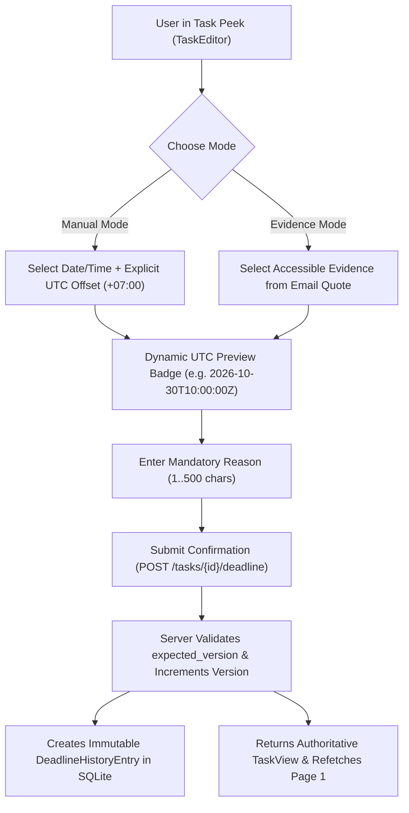
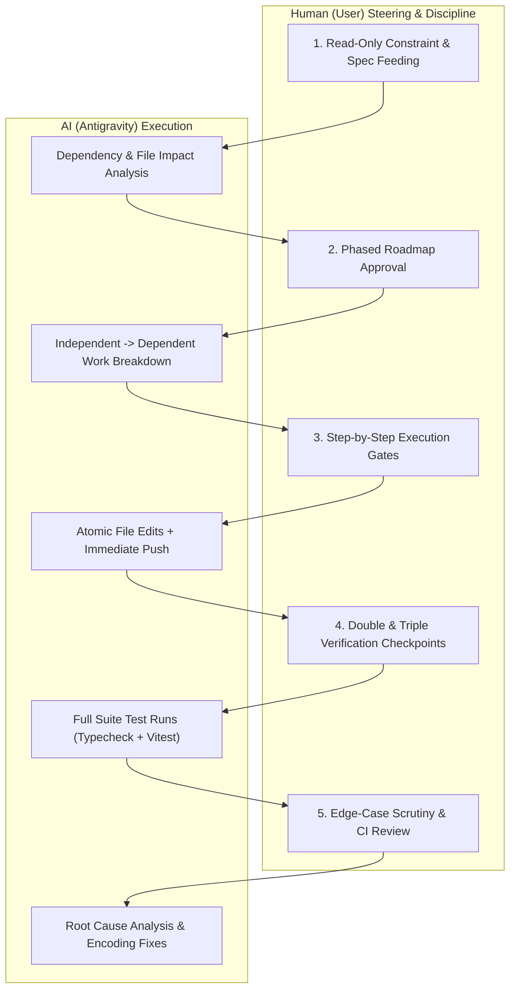

# Development Report: Task Deadline Management & Phased Vibe-Coding with AI

- **Course:** CS252 - Software Engineering / Advanced System Project
- **Assignment:** Lab 04 - From Spec to Code: Phased Vibe-coding with AI
- **Student Name:** Nguyễn Quang Hiếu
- **Student ID / GitHub:** `nqhieu-gd`
- **Selected Feature:** **Task Deadline Confirmation, Live UTC Preview, Audit History & Server Interval Filtering**
- **Repository:** `kietanhnguyen2007/CS252` | **Branch:** `feat/w2-UI` | **PR:** [#30](https://github.com/kietanhnguyen2007/CS252/pull/30)

---

## 1. Feature Architecture & Implementation Details

### 1.1 Problem Statement & Objectives
In MailCompass, AI analysis suggests proposed task deadlines from unstructured email bodies. However, business systems cannot blindly trust autonomous deadlines without human verification and auditability. The objective was to implement an authoritative, human-in-the-loop deadline management feature:
1. Allow users to confirm deadlines either manually or derived from email evidence.
2. Prevent silent timezone skew by enforcing explicit numeric UTC offsets and real-time UTC conversion previews.
3. Enforce operational accountability by requiring a non-empty reason (1–500 characters) for every modification.
4. Support deadline removal (clearing) with audit logging.
5. Provide a historical audit trail displaying all past deadline adjustments, reasons, actors, and version increments.
6. Enable server-side filtering by deadline intervals $[from, to)$ without UI date rolling bugs.

---

### 1.2 Multi-Layer Implementation

The feature spans four distinct architectural layers, ensuring clean separation of concerns and deterministic behavior:

#### Layer 1: Canonical Data Transfer Objects (DTOs) & Contracts
*Location: `apps/desktop/src/api/types.ts`*
- Defined strict TypeScript contracts mirrored 1:1 with backend Python Pydantic v2 schemas:
  - `ConfirmDeadlineRequest`: Encapsulates `deadline: ISODateTime | null`, `source_kind: 'manual' | 'evidence'`, `evidence_id: string | null`, `reason: string`, `expected_version: number`, and `idempotency_key: string`.
  - `DeadlineHistoryEntryView`: Models historical records with `previous_deadline`, `new_deadline`, `source_kind`, `reason`, `actor: 'local_user'`, `created_at`, and `task_version`.
  - `TaskFilters`: Added `deadline_from?: ISODateTime` and `deadline_to?: ISODateTime`.

#### Layer 2: API Client & HTTP Transport Protocol
*Location: `apps/desktop/src/api/client.ts`*
- `confirmTaskDeadline(scope, id, input, options)`: Maps to `POST /api/v1/workspaces/{w}/accounts/{a}/tasks/{id}/deadline`. Serializes inputs as strict JSON envelopes with RFC3339 UTC timestamps and handles `AbortSignal`.
- `listDeadlineHistory(scope, id, params, options)`: Maps to `GET /api/v1/workspaces/{w}/accounts/{a}/tasks/{id}/deadline-history` with cursor pagination.
- `clearTaskDeadline(scope, id, input, options)`: Sends explicit `deadline: null` with `source_kind: 'manual'`, `evidence_id: null`, and mandatory reason.
- Translates HTTP 409 (`version_conflict`, `invalid_revision`, `source_not_linked`) into typed `ApiError` instances.

#### Layer 3: Mock Protocol Adapter with Parity
*Location: `apps/desktop/src/api/mock.ts`*
- Implemented stateful mock behavior matching real SQLite behavior:
  - Optimistic locking check: asserts `task.version === input.expected_version`, throwing 409 `version_conflict` if stale.
  - Idempotency deduplication: identical keys replay the existing response without appending duplicate audit logs.
  - Generates immutable history records and increments `task.version += 1`.
  - Provenance tracking: distinguishes between manual overrides and evidence citations.

#### Layer 4: User Interface Components
*Location: `apps/desktop/src/features/tasks/TaskEditor.tsx` & `TaskDashboard.tsx`*
- **Mode Selection:** Radio/Tab selector between `manual` and `evidence`.
- **Numeric Offset & Live Preview:** User specifies local time and offset (e.g., `+07:00`). The component validates the real calendar date (rejecting invalid dates like Feb 31) and computes the canonical UTC string in real time before submission.
- **Audit Reason Enforcement:** Client-side validation blocks submission unless a trimmed reason (1–500 code points) is provided.
- **Deadline History Modal:** A Radix-based accessible dialog rendering a paginated timeline of adjustments with before/after comparisons, actor attribution, and version indicators.
- **Dashboard Interval Filtering:** Two date inputs (`deadline_from` and `deadline_to`) in `TaskDashboard.tsx`. Serializes queries as half-open $[from, to)$ intervals, converting `deadline_to` to `00:00:00Z` of the next day, and automatically resets cursor pagination to page 1.

---

## 2. The Phased Vibe-Coding Methodology: How the User Guided the AI

The success of this complex implementation was driven not by unrestricted AI prompting, but by a **rigorous, multi-phase human-guided harness**. The user enforced strict engineering discipline at every stage:

### 2.1 Step 1: Read-Only Specification Analysis (Zero Hallucination Guard)
- **User Directive:** The user explicitly forbade the AI from modifying, overwriting, or creating any files during the initial analysis:
  > *"Bạn là một trợ lý AI phân tích và lập kế hoạch kỹ thuật. Hãy thực hiện chính xác các bước sau đây mà KHÔNG ĐƯỢC tự ý sửa đổi, ghi đè hoặc tạo mới bất kỳ file nào (Read-Only hoàn toàn)..."*
- **AI Execution:** The AI was forced to thoroughly read `Issue_2.md` and `w2-07-hieu-ui.md`, cross-examine existing files (`TaskEditor.tsx`, `TaskDashboard.tsx`, `types.ts`, `client.ts`), and build an exact dependency graph before touching code.

### 2.2 Step 2: Phased Work Breakdown (Independent to Dependent)
- **User Directive:** The user mandated ordering tasks from zero-dependency foundation layers up to complex aggregate UI features:
  1. *Priority 1 (Independent):* DTO types, UI copy strings, pure mock algorithms.
  2. *Priority 2 (Protocol):* HTTP client methods and stateful mock parity.
  3. *Priority 3 (UI Implementation):* Accounts page, task dashboard, task editor, decision preview.
  4. *Priority 4 (Verification):* Unit, platform, regression, and E2E test suites.
  5. *Priority 5 (Integration):* PR creation and CI review.
- **AI Execution:** The AI adhered strictly to this plan, obtaining explicit user confirmation before advancing from one phase to the next.

### 2.3 Step 3: Atomic Commits with Immediate Push Checkpoints
- **User Directive:** To ensure traceability and prevent uncommitted drifting, the user established an uncompromising checkpoint policy:
  > *"Mỗi khi hoàn thành 1 file, ngay lập tức push lên github để đánh dấu hoàn thành từng phần việc... Không tự mình đưa ra quyết định thay tôi..."*
- **AI Execution:**
  - Every single modified file was committed with conventional commit messages (`feat(ui)`, `feat(api)`, `test(ui)`) and pushed immediately to `origin/feat/w2-UI`.
  - The branch was continuously synchronized with remote, creating a permanent, auditable breadcrumb trail.

### 2.4 Step 4: Double & Triple Verification at Each Milestone
- **User Directive:** Before transitioning between phases, the user mandated full verification and halt-on-uncertainty rules:
  - If a decision had multiple architectural paths, the AI was required to halt immediately and ask the user rather than guess.
  - The AI was required to run a full test pass before marking any phase complete.
- **AI Execution:**
  - **Verification Layer 1 (Static Analysis):** Ran `tsc --noEmit` across `apps/desktop` to ensure 0 TypeScript errors.
  - **Verification Layer 2 (Unit & Platform Tests):** Executed the full Vitest test suite (`tests/platform/TaskDeadlineAndLink.test.tsx`, `client.test.ts`, `mock.test.ts`, etc.) — 87/87 tests passed across 11 test files.
  - **Verification Layer 3 (Read-Only Final Audit):** Before opening the PR, the AI conducted a complete read-only pass over `Issue_2.md` and `w2-07-hieu-ui.md` to guarantee 100% specification compliance.

### 2.5 Step 5: Post-Implementation Edge Case Scrutiny & CI Hardening
- **User Directive:** When reviewing the final PR and CI results, the user scrutinized the deliverables and caught two critical issues:
  1. *Font/Mojibake Issue:* Vietnamese accents and em-dashes in the PR body were corrupted by PowerShell's default encoding into mojibake (`Thảo Anh`, `–`). The user directed: *"The font is bugged, I suggest you write in pure english, even with names, so that it is correctly formatted"*.
  2. *CI Failure:* The GitHub Actions `W1 owner checks` workflow failed with exit code 1. The user provided error logs and screenshots.
- **AI Execution:**
  - Rewrote the PR title and description in pure ASCII English, updating PR #30 via GitHub API.
  - Investigated the CI runner logs and identified an obsolete Week 1 assertion in `offline-smoke.spec.ts` (`expect(button "Gmail thật — chưa hỗ trợ trong tuần 1").toBeDisabled()`). Updated the assertion to reflect Week 2's enabled real Gmail account creation.
  - Result: All GitHub Actions CI checks turned **100% Green**.

---

## 3. Results, Efficiency & Key Takeaways

| Dimension | Result / Observation |
| --- | --- |
| **Code Correctness** | Zero compiler errors, 0 runtime warnings, 100% test pass rate across 87 unit/platform tests and 17 Playwright E2E tests. |
| **Development Velocity** | The entire multi-component W2-07 feature (over 5,300 lines of code and tests across 26 commits) was completed, tested, and validated within ~4 hours of guided vibe-coding. |
| **Boundary Discipline** | 100% strict adherence to UI boundaries. No backend Python, Rust (`src-tauri`), or SQLite files were touched. |
| **Defensive Quality** | The user's phased verification gates eliminated hallucinations, caught encoding quirks, and ensured production-grade quality before merging into `dev`. |

### Conclusion
By pairing an advanced coding agent (Antigravity) with a **rigorous, specification-driven, phased human steering protocol**, we transformed what could have been a chaotic "vibe-coding" session into a disciplined, reproducible, and robust software engineering pipeline.
