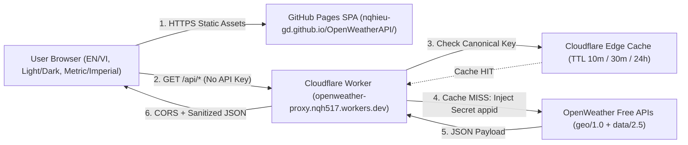
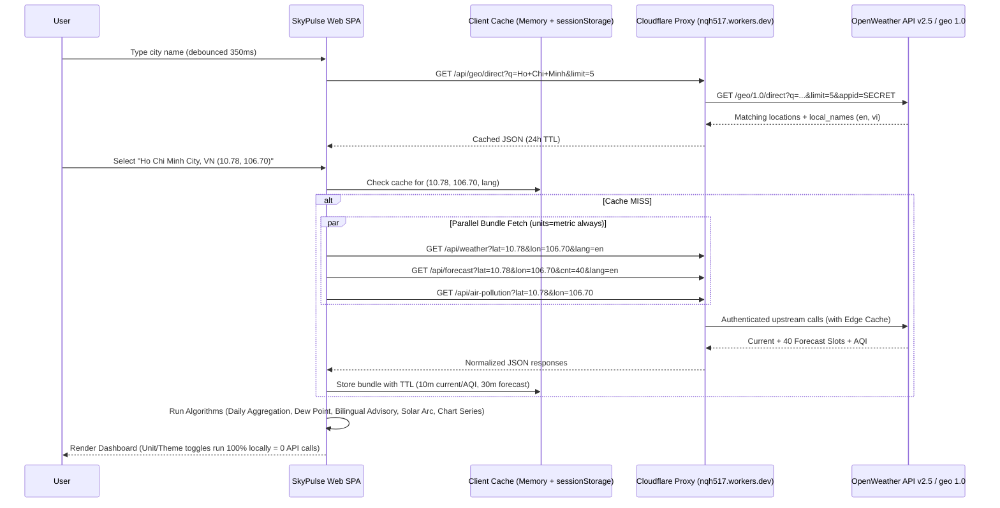

# Lab 06 — SkyPulse OpenWeather Web Application Implementation Plan

**Course:** CS252 — Programming Systems (Week 6)  
**Assignment Reference:** [Lab06-OpenStreetMap API-OpenWeather API.pdf](./Lab06-OpenStreetMap%20API-OpenWeather%20API.pdf)  
**Tutorial Reference:** [Lab_Introduction_to_OpenWeatherAPI.ipynb](./Lab_Introduction_to_OpenWeatherAPI.ipynb)  
**Target Web Repository:** `https://github.com/nqhieu-gd/OpenWeatherAPI`  
**Live Deployment URL (Priority):** `https://nqhieu-gd.github.io/OpenWeatherAPI/`  
**Cloudflare Worker Proxy URL:** `https://openweather-proxy.nqh517.workers.dev`  
**Total Infrastructure & API Cost:** **\$0** (100% Free Tier — no credit card required)

---

## 1. Assignment & Tutorial Grounding

### 1.1 Course Requirements (`Lab06-OpenStreetMap API-OpenWeather API.pdf`)
- **Goal:** Develop a standalone, **meaningful website** integrating the **OpenWeather API** (OpenStreetMap API is intentionally omitted).
- **Mandatory Submission Artifacts:**
  1. **Explanation** — Clear description of the website, its functionality, algorithms, and API integration (**both `.md` and `.pdf`**).
  2. **Source Code** — Complete implementation directly browsable under `W6/OpenWeatherAPI/` and synced to `https://github.com/nqhieu-gd/OpenWeatherAPI`.
  3. **Video Demonstration** — Screen recording walking through live website features and OpenWeather API integration.
  4. **AI Usage Declaration** — Transparent breakdown of student ownership vs. AI assistance (**both `.md` and `.pdf`**).
  5. **Git Commit History** — Clean, atomic commit history recorded in `W6/Git Commit Log.md`.

### 1.2 Direct Traceability to `Lab_Introduction_to_OpenWeatherAPI.ipynb`

| Notebook Reference | Concept / Endpoint Taught | How SkyPulse Implements & Extends It |
| :--- | :--- | :--- |
| **Cell 1 (Overview)** | 1) Request current weather & forecast; 2) Obtain easy-to-understand weather advice or summaries | Live global weather dashboard + **Bilingual Smart Weather Summary & Actionable Advice Engine (EN/VI)** built cleanly on Free Plan data |
| **Cells 10 & 22 (Security Rule)** | *"You must not let your API key be shared on the internet under any circumstances... remove your API_KEY before uploading to GitHub"* | Zero API keys in Git, GitHub Actions, or browser bundles; `OPENWEATHER_API_KEY` stored exclusively as an encrypted Cloudflare Worker secret (`wrangler secret`) and gitignored local `.env`/`.dev.vars` |
| **Cells 13, 14, 17, 24, 29 (Config Rule)** | *"Never hardcode the API URL directly in your code. Always define the API URL as a configuration or setting variable."* | All frontend routes live in `web/src/config/apiConfig.ts`; all upstream OpenWeather base URLs live in `proxy/src/endpoints.ts` |
| **Cell 13 (Section 3.1)** | Direct Geocoding: `geo/1.0/direct` *(upgraded from `http://` to `https://` for GitHub Pages HTTPS compliance)* | Global city search & autocomplete (`limit=5`) with multi-city disambiguation + Vietnam & international quick-jump chips |
| **Cells 14–15 (Section 3.1)** | Current Weather v2.5: `https://api.openweathermap.org/data/2.5/weather` *(demo city: Ho Chi Minh City, Vietnam)* | Hero weather card + atmospheric metrics; default landing city is **Ho Chi Minh City, Vietnam** with default `units=metric` (`°C`, `m/s`) |
| **Cells 17–20 (Section 3.2)** | 5-Day / 3-Hour Forecast v2.5: `https://api.openweathermap.org/data/2.5/forecast` | Full 40-slot (`cnt=40`) timeline powering **Interactive Charts** and a **Timezone-Safe 5-Day Daily Aggregation Algorithm** (solving Cell 31's v2.5 daily-forecast gap) |
| **Free-Tier Bonus Endpoints** *(verified \$0, same default key)* | Reverse Geocoding (`geo/1.0/reverse`) & Air Pollution (`data/2.5/air_pollution`) | Browser GPS **"Use My Location"** button + live **Air Quality Index (AQI 1–5)** with `PM2.5`, `PM10`, `O₃`, `NO₂`, `SO₂`, `CO` |
| **Cells 21–31 (Section 4)** | One Call API v3.0 (`3.0/onecall`, `3.0/onecall/overview`) — requires Visa/Mastercard & charges 0.0012 GBP/call past 1,000/day | **Intentionally excluded** to guarantee \$0 cost and zero billing risk. Its human-readable summary goal (Cell 30) is fulfilled deterministically in EN & VI on v2.5 data |

---

## 2. System Architecture & Request Lifecycle

### 2.1 High-Level Architecture (Option A — GitHub Pages + Cloudflare Worker Proxy)
GitHub Pages serves only static files. Placing an API key in frontend JS leaks it publicly (violating Cell 10), while asking an instructor to supply their own key degrades UX. Therefore, **SkyPulse** separates static UI delivery from authenticated API proxying:

- **Static Frontend (`web/`)**: React 19 + TypeScript + Vite SPA built with `base: '/OpenWeatherAPI/'` and auto-deployed via GitHub Actions to `https://nqhieu-gd.github.io/OpenWeatherAPI/`.
- **Edge API Proxy (`proxy/`)**: A lightweight Cloudflare Worker deployed to **`https://openweather-proxy.nqh517.workers.dev`** (Free Plan: 100,000 req/day, \$0, no credit card, no cold-start sleep, no overage billing).
  - Holds `OPENWEATHER_API_KEY` as an encrypted Worker secret.
  - Enforces strict CORS allowlist (`https://nqhieu-gd.github.io`, `http://localhost:5173`, `http://127.0.0.1:5173`).
  - Validates and allowlists all routes & parameters (cannot be abused as an open proxy).
  - Caches upstream OpenWeather JSON at Cloudflare's edge (`caches.default`) to protect the 60 calls/min Free Plan quota.
- **Local Development Mode**: Vite's `vite.config.ts` dev middleware proxies `/api/*` directly to OpenWeather using local gitignored `.env` (or `wrangler dev` inside `proxy/`), enabling single-command local runs (`npm.cmd run dev`).



### 2.2 City Load Sequence (Minimizing Quota Usage)



---

## 3. Required Repositories, Libraries & Copyright Compliance

Every package uses a permissive open-source license (MIT / ISC / Apache-2.0).

### 3.1 Frontend, UI/UX & Visualization (`web/package.json`)

| Role | Package | Version Target | Purpose | License |
| :--- | :--- | :--- | :--- | :--- |
| **UI Library** | `react`, `react-dom` | `^19.x` | Declarative reactive UI components & state hooks | MIT |
| **Type Safety** | `typescript` | `^5.x` | Strict typing for OpenWeather DTOs, algorithms, and compile-time EN/VI key parity | Apache-2.0 |
| **Build & Dev Tool** | `vite`, `@vitejs/plugin-react` | `^6.x` | Fast HMR, local `/api` dev proxy middleware, GitHub Pages production bundle | MIT |
| **Styling** | `tailwindcss`, `@tailwindcss/vite` | `^4.x` | Responsive layout utilities paired with semantic CSS custom properties for Light/Dark theming | MIT |
| **Interactive Charts** | `recharts` | `^2.x` | Responsive SVG charts (Area/Line/Bar/Composed) with accessible dynamic tooltips & dark-mode styling | MIT |
| **Vector Icons** | `lucide-react` | `^0.x` | Crisp UI & meteorological icons without copyright restrictions | ISC |
| **i18n Localization** | Custom typed module (`src/i18n/`) + Web `Intl` API | Native | Zero-bloat English (default) & Vietnamese dictionary with compile-time parity + `lang=en\|vi` upstream sync | Project own code |

### 3.2 Background, Algorithm & Proxy Layer (`proxy/package.json` & `web/src/algorithms/`)

| Role | Package / Module | Purpose | License |
| :--- | :--- | :--- | :--- |
| **Algorithm Engine** | Pure TypeScript (`web/src/algorithms/*.ts`) | Timezone-safe 5-day aggregation, Magnus dew-point & comfort classifier, bilingual weather summary & advice synthesis, Beaufort wind scale, solar arc geometry, unit conversions | Project own code |
| **HTTP & Caching** | Native `fetch` + `AbortController` + `weatherCache.ts` | Zero-dependency HTTP calls, debounce cancellation, two-tier TTL cache, in-flight request deduplication, HTTP `429` retry guard | Web Standard |
| **Serverless Proxy** | `wrangler`, `@cloudflare/workers-types` | TypeScript compilation, local emulation (`wrangler dev`), secret upload, and deployment to `openweather-proxy.nqh517.workers.dev` | MIT / Apache-2.0 |

### 3.3 Verification, CI/CD & Documentation Tooling

| Role | Package / Tool | Purpose | License |
| :--- | :--- | :--- | :--- |
| **Typecheck & Lint** | `tsc --noEmit`, `eslint`, `typescript-eslint` | Static verification before commits | Apache-2.0 / MIT |
| **Algorithm & Parity Tests** | `vitest` *(lightweight unit test runner)* | Automated verification of pure algorithms (cross-timezone aggregation, Magnus formula, advisory engine, unit conversion, EN/VI key parity) | MIT |
| **GitHub Pages CI** | `actions/checkout@v4`, `actions/setup-node@v4`, `actions/configure-pages@v5`, `actions/upload-pages-artifact@v3`, `actions/deploy-pages@v4` | Automatic static build & GitHub Pages publish on push to `main` | MIT |
| **PDF Export** | Headless Chrome / Edge Print-to-PDF or Pandoc | Converts `Explanation_and_AI_Declaration.md` -> `.pdf` binary deliverable | Standard tool (not bundled) |

### 3.4 Copyright, Attribution & Privacy Compliance
- **OpenWeather Attribution (Required by CC BY-SA 4.0)**: Website footer permanently displays *"Weather data provided by OpenWeather"* linking to `https://openweathermap.org/`.
- **Icons & Visuals**: All icons are ISC-licensed `lucide-react` vectors (optionally paired with official OpenWeather weather condition icons via `https://openweathermap.org/img/wn/{code}@2x.png` with attribution); backgrounds are pure CSS gradients.
- **Public Privacy**: The live public website footer displays the project name (**SkyPulse**) and OpenWeather attribution only (keeping student ID inside course documentation in `W6/docs/` and `W6/README.md`).

---

## 4. UI / UX Design Specification

### 4.1 Responsive Layout Structure (12-Column Bento Dashboard)
- **Breakpoints:** Desktop (`>= 1024px`, 12-col grid), Tablet (`768px–1023px`, 2-col stacked), Mobile (`< 768px`, single-column touch-friendly layout).

```text
+------------------------------------------------------------------------------+
| [SkyPulse Logo]   [ Search any city worldwide... (Ctrl+K) ] [GPS]            |
|                   [°C | °F]   [EN | VI]   [Light / Dark]                     |
+------------------------------------------------------------------------------+
| Quick Cities: [Ho Chi Minh City] [Ha Noi] [Da Nang] [Ben Tre] [Can Tho]      |
|               [Tokyo] [London] [New York]                                    |
+----------------------------------------+-------------------------------------+
| HERO CURRENT WEATHER (7 cols)          | SMART SUMMARY & ADVICE (5 cols)     |
| Ho Chi Minh City, VN · 19:35 (UTC+7)   | "Currently 29°C with broken clouds  |
|   [Weather Icon]   29°C                |  and muggy humidity (78%)..."       |
|   Broken Clouds · Feels like 34°C      | [Umbrella] Rain likely ~15:00 (75%) |
|   Today: Low 25°C / High 32°C          | [Comfort]  Warm & humid — hydrate   |
|   Updated 2m ago · [Refresh]           | [Wind]     Gentle breeze (4.2 m/s)  |
|                                        | [AQI]      Fair (AQI 2 · PM2.5 18)  |
+----------------------------------------+-------------------------------------+
| METRICS GRID (4 equal cards on desktop, 2x2 on tablet/mobile)                |
| [Humidity & Dew Point] [Wind & Compass] [Air Quality AQI] [Daylight Sun Arc] |
+------------------------------------------------------------------------------+
| INTERACTIVE FORECAST CHARTS (Full width)                                     |
| Range: [24 Hours] [5 Days]   Metric: [Temperature] [Precipitation] [Wind/RH] |
|  ~ Smooth Recharts SVG Area / Composed Bar-Line Chart + Hover Tooltip ~      |
+------------------------------------------------------------------------------+
| 5-DAY DAILY FORECAST (Aggregated from 3-Hour Slots — Click Any Day to Expand)|
| > Fri, Nov 20  [Icon] Moderate Rain   Rain 80%   24°C [========] 31°C        |
|   (Expanded: 8 horizontal 3-hour cards: 00:00, 03:00, ..., 21:00 local time) |
| > Sat, Nov 21  [Icon] Light Rain      Rain 60%   25°C  [=======] 32°C        |
+------------------------------------------------------------------------------+
| Footer: SkyPulse · Weather data provided by OpenWeather (CC BY-SA 4.0)       |
+------------------------------------------------------------------------------+
```

### 4.2 Design Tokens (Light & Dark Mode — Follow OS Default)
- **Theme Initialization**: An inline `<script>` in `web/index.html` reads `localStorage.getItem('skypulse_theme')`, falling back to `window.matchMedia('(prefers-color-scheme: dark)').matches`, and sets `document.documentElement.dataset.theme` **before first paint** (zero white flash).

| Semantic Token | Light Mode (`data-theme="light"`) | Dark Mode (`data-theme="dark"`) | Usage |
| :--- | :--- | :--- | :--- |
| `--bg-canvas` | `#F1F5F9` | `#09111E` | Page background |
| `--bg-surface` | `#FFFFFF` | `#111C2E` | Primary cards & search dropdown |
| `--bg-surface-muted` | `#F8FAFC` | `#18263D` | Metric inner tiles, expanded 3h cards |
| `--border-subtle` | `#E2E8F0` | `#23334D` | Hairline card borders & chart gridlines |
| `--text-primary` | `#0F172A` | `#F8FAFC` | Temperatures, headings (Contrast > 12:1) |
| `--text-secondary` | `#475569` | `#94A3B8` | Labels, timestamps (Contrast >= 4.6:1) |
| `--accent-primary` | `#0284C7` | `#38BDF8` | Active tabs, focus rings, temp curve |
| `--accent-warm` | `#EA580C` | `#FB923C` | Feels-like curve, high-temp markers |
| `--accent-rain` | `#2563EB` | `#60A5FA` | Precipitation bars & rain badges |
| `--status-good` | `#15803D` | `#4ADE80` | AQI 1–2 / Comfortable |
| `--status-caution` | `#B45309` | `#FBBF24` | AQI 3 / Moderate rain or heat caution |
| `--status-warning` | `#B91C1C` | `#F87171` | AQI 4–5 / Storm, extreme heat, errors |

- **Weather-Reactive Hero Gradients** (subtle translucent backdrop tint on the Hero Card mapped from OpenWeather condition group `weather[0].id` + day/night icon suffix `d`/`n`):
  - `800` Clear Day (warm sky blue) / Clear Night (deep indigo)
  - `801–804` Clouds (cool slate blue)
  - `3xx / 5xx` Drizzle & Rain (steel ocean blue)
  - `2xx` Thunderstorm (violet-slate accent)
  - `7xx` Mist / Haze / Fog (soft silver-amber)

### 4.3 Bilingual Localization (English Default + Vietnamese Toggle)
- Default locale: **`en`** (English); instant header toggle to **`vi`** (Vietnamese), persisted in `localStorage` (`skypulse_lang`).
- **Dual-Layer Localization**:
  1. **UI & Algorithms**: Compile-time checked dictionaries (`en.ts`, `vi.ts`) translate all headings, tabs, tooltips, advice rules, AQI grades (`Good / Fair / Moderate / Poor / Very Poor` <-> `Tốt / Khá / Trung bình / Kém / Rất kém`), Beaufort wind scales, and 8-point compass labels (`N, NE, E, SE, S, SW, W, NW` <-> `B, ĐB, Đ, ĐN, N, TN, T, TB`).
  2. **OpenWeather API Sync**: Passes `lang=en` or `lang=vi` upstream and uses `local_names.vi` / `local_names.en` from Geocoding responses (e.g., `Ho Chi Minh City` <-> `Thành phố Hồ Chí Minh`).

### 4.4 UX Edge States & Accessibility
- **Skeleton Loaders**: Match final card heights so loading causes zero layout jump.
- **Disambiguation Dropdown**: Displays `Name, State, Country` + `(lat, lon)` so identically named cities globally are clearly distinguishable; supports `ArrowUp`, `ArrowDown`, `Enter`, `Escape`, and `Ctrl+K` focus shortcut.
- **Error Banners**:
  - **City Not Found**: Bilingual hint to check spelling or include country code (e.g., `Da Lat, VN`).
  - **HTTP 429 Rate Limit** *(matching Notebook Cell 31)*: Displays countdown timer & serves cached data if available.
  - **GPS Permission Denied / Unavailable**: Non-blocking toast explaining browser location was denied while leaving search active.
  - **Offline / Proxy Unreachable**: Retry button + clear status message.
- **Accessibility**: Semantic landmarks (`<header>`, `<main>`, `<section>`, `<footer>`), `aria-live="polite"` status updates, ARIA labels on toggles, and `prefers-reduced-motion` support.

---

## 5. Complete Function Catalog & Methods to Encode Each Function

### 5.1 Core TypeScript Data Contracts (`web/src/types/weather.ts`)

```ts
export type Locale = 'en' | 'vi';
export type UnitSystem = 'metric' | 'imperial';
export type ThemeMode = 'light' | 'dark';

export interface GeoLocation {
  id: string;                 // `${lat.toFixed(3)},${lon.toFixed(3)}`
  name: string;
  localNames?: { en?: string; vi?: string };
  state?: string;
  country: string;
  lat: number;
  lon: number;
}

export interface CurrentWeatherDTO {
  dt: number;                 // Unix UTC seconds
  timezoneOffsetSec: number;  // Seconds offset from UTC
  tempC: number;
  feelsLikeC: number;
  tempMinC: number;
  tempMaxC: number;
  humidityPct: number;
  pressureHpa: number;
  visibilityMeters: number;
  cloudsPct: number;
  windSpeedMs: number;
  windDeg: number;
  windGustMs?: number;
  rain1hMm?: number;
  sunriseUtcSec: number;
  sunsetUtcSec: number;
  condition: { id: number; main: string; description: string; icon: string };
}

export interface ForecastSlotDTO {
  dt: number;
  tempC: number;
  feelsLikeC: number;
  tempMinC: number;
  tempMaxC: number;
  humidityPct: number;
  windSpeedMs: number;
  windDeg: number;
  pop: number;                // Probability of precipitation [0..1]
  rain3hMm: number;           // Default 0 if absent
  condition: { id: number; main: string; description: string; icon: string };
}

export interface AirQualityDTO {
  dt: number;
  aqi: 1 | 2 | 3 | 4 | 5;
  components: {
    pm2_5: number;
    pm10: number;
    o3: number;
    no2: number;
    so2: number;
    co: number;
  };
}

export interface DailyForecastSummary {
  dateKey: string;            // Destination local "YYYY-MM-DD"
  noonTimestampUtcSec: number;
  tempMinC: number;
  tempMaxC: number;
  maxPop: number;
  totalRainMm: number;
  avgHumidityPct: number;
  maxWindSpeedMs: number;
  representativeCondition: ForecastSlotDTO['condition'];
  slots: ForecastSlotDTO[];
}

export interface AdvisoryItem {
  category: 'rain' | 'thermal' | 'wind' | 'air' | 'storm';
  severity: 'info' | 'caution' | 'warning';
  title: string;
  detail: string;
}

export interface WeatherAdvisoryResult {
  summaryText: string;
  advisories: AdvisoryItem[];
}
```

---

### 5.2 Function-by-Function Encoding Specifications

#### F1. Centralized Configuration (`web/src/config/apiConfig.ts`, `proxy/src/endpoints.ts`)
- **Rule Satisfied:** Notebook Cells 13–29 (*never hardcode API URLs inside functions*).
- **Encoding Method:**
  - `web/src/config/apiConfig.ts` reads `import.meta.env.VITE_API_BASE_URL || '/api'` and exports `API_ROUTES` (`GEO_DIRECT`, `GEO_REVERSE`, `WEATHER`, `FORECAST`, `AIR_POLLUTION`) plus `CURATED_CITIES` (Ho Chi Minh City, Ha Noi, Da Nang, Ben Tre, Can Tho, Tokyo, London, New York) with pre-verified coordinates so quick-chip clicks skip geocoding and save 1 API call!
  - `proxy/src/endpoints.ts` builds upstream URLs exclusively from `const OPENWEATHER_BASE_URL = 'https://api.openweathermap.org'`.

#### F2. Cloudflare Worker API Proxy (`proxy/src/index.ts`, `proxy/src/validation.ts`)
- **Live URL:** `https://openweather-proxy.nqh517.workers.dev`
- **Routes Exposed:**
  - `GET /api/geo/direct?q=<string>&limit=<1..5>` -> `https://api.openweathermap.org/geo/1.0/direct`
  - `GET /api/geo/reverse?lat=<num>&lon=<num>&limit=1` -> `https://api.openweathermap.org/geo/1.0/reverse`
  - `GET /api/weather?lat=<num>&lon=<num>&lang=<en|vi>` -> `https://api.openweathermap.org/data/2.5/weather` (`units=metric` enforced)
  - `GET /api/forecast?lat=<num>&lon=<num>&cnt=<1..40>&lang=<en|vi>` -> `https://api.openweathermap.org/data/2.5/forecast` (`units=metric` enforced)
  - `GET /api/air-pollution?lat=<num>&lon=<num>` -> `https://api.openweathermap.org/data/2.5/air_pollution`
- **Encoding Method:**
  1. Handle `OPTIONS` CORS preflight using `ALLOWED_ORIGINS` env var (`https://nqhieu-gd.github.io,http://localhost:5173,http://127.0.0.1:5173`). Reject unauthorized origins with `403`.
  2. Reject non-`GET` methods (`405`) and unknown paths (`404`).
  3. Validate all query parameters in `validation.ts`:
     - `lat`: `Number.isFinite(v) && v >= -90 && v <= 90`, normalized via `v.toFixed(3)` (~110m grid to boost cache hits).
     - `lon`: `Number.isFinite(v) && v >= -180 && v <= 180`, normalized via `v.toFixed(3)`.
     - `q`: trimmed string, `1 <= length <= 100`.
     - `lang`: allowlist `'en' | 'vi'` (default `'en'`).
     - `cnt`: integer clamped `[1, 40]` (default `40`); `limit`: integer clamped `[1, 5]` (default `5`).
  4. Build canonical cache request URL (strictly excluding `appid`), check `caches.default.match(cacheKey)`.
  5. On miss, fetch upstream OpenWeather with `env.OPENWEATHER_API_KEY` appended and `AbortSignal.timeout(10_000)`.
  6. On HTTP `200`, clone response, attach `Cache-Control: public, max-age=<TTL>` (`86400`s geocoding, `600`s weather/AQI, `1800`s forecast) + `X-Cache: MISS`, store via `ctx.waitUntil(caches.default.put(...))`, and return with CORS headers.
  7. On non-`200` (e.g., `401`, `404`, `429`, `5xx`), return sanitized JSON `{ error: { code, message, retryAfterSec? } }` — **stripping any secret key or upstream URL**.

#### F3. Local Vite Dev Proxy Middleware (`web/vite.config.ts`)
- **Purpose:** Lets `npm.cmd run dev` run locally with live OpenWeather data even without running `wrangler dev`.
- **Encoding Method:**
  - When `VITE_API_BASE_URL` is unset, Vite's `server.proxy` or custom dev plugin intercepts `/api/*`, loads `OPENWEATHER_API_KEY` from local gitignored `web/.env` via `loadEnv(mode, process.cwd(), '')` (server-side only — never exposed via `VITE_` prefix!), injects `appid`, and forwards to OpenWeather.

#### F4. Direct City Geocoding (`web/src/services/openWeatherClient.ts#searchCities`)
- **Tutorial Mapping:** `get_current_city_lat_lon` (Cell 13).
- **Encoding Method:**
  - Triggered after a `350ms` debounce in `CitySearch.tsx`; creates a fresh `AbortController` and aborts any superseded request.
  - Calls `GET ${API_ROUTES.GEO_DIRECT}?q=${encodeURIComponent(query)}&limit=5`.
  - Maps raw objects to `GeoLocation[]` and deduplicates repeated entries by `${name.toLowerCase()}|${(state ?? '').toLowerCase()}|${country}`.

#### F5. Reverse Geocoding + Browser Geolocation (`reverseGeocode` + `useGeolocation`)
- **Encoding Method:**
  - Calls `navigator.geolocation.getCurrentPosition(onSuccess, onError, { enableHighAccuracy: false, timeout: 8000, maximumAge: 300_000 })`.
  - Sends `(coords.latitude, coords.longitude)` to `GET ${API_ROUTES.GEO_REVERSE}?lat=...&lon=...&limit=1`.
  - Falls back to coordinate label `Current Location (lat, lon)` if reverse geocoding returns an empty list, and surfaces clear localized messages for `PERMISSION_DENIED`, `POSITION_UNAVAILABLE`, and `TIMEOUT`.

#### F6. Parallel Weather Bundle Loader (`fetchWeatherBundle`)
- **Tutorial Mapping:** `get_current_city_weather` (Cell 14) + `get_3_hours_city_weather` (Cell 17) + Free-Tier Air Pollution.
- **Encoding Method:**
  - Always requests `units=metric` upstream so switching `°C <-> °F` or `m/s <-> mph` happens instantaneously in-memory with **0 extra API calls**.
  - Runs `Promise.allSettled([fetchCurrent, fetchForecast, fetchAirPollution])`.
  - Requires `current` and `forecast` to succeed; treats `airPollution` as graceful-degradation optional (returns `null` if unavailable so the main dashboard never crashes).
  - Normalizes every field into `CurrentWeatherDTO`, `ForecastSlotDTO[]`, and `AirQualityDTO | null`.

#### F7. Two-Tier Client Cache & HTTP 429 Guard (`web/src/services/weatherCache.ts`)
- **Encoding Method:**
  - Cache key: `${endpoint}:${lat.toFixed(2)}:${lon.toFixed(2)}:${lang}`.
  - Lookup order: in-memory `Map` -> `sessionStorage` JSON entry (checked against `Date.now() < expiresAt`) -> network fetch.
  - Deduplicates concurrent identical calls via `inFlight: Map<string, Promise<T>>`.
  - When HTTP `429` arrives, reads `Retry-After` (default `60`s), throws typed `RateLimitError(retryAfterSec)`, and lets the UI show a localized countdown banner while retaining last valid cached data if present.

#### F8. Destination-Timezone 5-Day Daily Aggregation (`web/src/algorithms/aggregateDaily.ts`)
- **Why Needed:** OpenWeather v2.5 Free Plan does not provide a `/daily` endpoint (Cell 31).
- **Encoding Method:**
  1. For each 3-hour slot `s`, shift Unix UTC timestamp by destination timezone offset:
     `localDate = new Date((s.dt + timezoneOffsetSec) * 1000)`
  2. Extract destination calendar key using UTC accessors (`getUTCFullYear`, `getUTCMonth + 1`, `getUTCDate`) -> `YYYY-MM-DD`, and local hour `localHour = localDate.getUTCHours()`. *(Using UTC accessors on the shifted timestamp avoids browser-timezone bugs when a user in Vietnam inspects New York or London!)*
  3. Group slots in chronological order into `Map<string, ForecastSlotDTO[]>`.
  4. Reduce each day's slots:
     - `tempMinC = min(slot.tempMinC)`
     - `tempMaxC = max(slot.tempMaxC)`
     - `maxPop = max(slot.pop)`
     - `totalRainMm = round1(sum(slot.rain3hMm))`
     - `avgHumidityPct = Math.round(mean(slot.humidityPct))`
     - `maxWindSpeedMs = max(slot.windSpeedMs)`
  5. **Representative Condition Selection**:
     - If any daytime slot (`06 <= localHour <= 21`) has Thunderstorm (`200–299`) or Heavy Rain (`502–504`), pick the highest-severity daytime condition so severe weather is never hidden behind a clear morning slot.
     - Otherwise, pick the slot with minimum `|localHour - 12|` (closest to local midday).

#### F9. Magnus Dew Point & Thermal Comfort Classifier (`web/src/algorithms/dewPointComfort.ts`)
- **Encoding Method:**
  - Clamp relative humidity $RH \in [1, 100]$ and apply the **Magnus-Tetens formula** ($a = 17.625$, $b = 243.04^\circ\text{C}$):
    $$\alpha(T, RH) = \ln\!\left(\frac{RH}{100}\right) + \frac{a \cdot T}{b + T}, \qquad T_d = \frac{b \cdot \alpha}{a - \alpha}$$
  - Classify thermal comfort using both `feelsLikeC` and `dewPointC`:
    - `extreme_heat`: `feelsLikeC >= 38`
    - `hot`: `feelsLikeC >= 33`
    - `warm_humid`: `feelsLikeC >= 27 && dewPointC >= 22` *(especially accurate for Ho Chi Minh City & Mekong Delta!)*
    - `comfortable`: `18 <= feelsLikeC < 27` (or `< 30` with `dewPointC < 22`)
    - `cool`: `10 <= feelsLikeC < 18`
    - `cold`: `feelsLikeC < 10`

#### F10. Bilingual Smart Weather Summary & Actionable Advice Engine (`web/src/algorithms/weatherAdvisory.ts`)
- **Why Needed:** Directly fulfills Tutorial Cell 1 Objective #2 (*"easy-to-understand weather advice or summaries"*) in both English & Vietnamese without paid One Call v3.0 `overview`.
- **Encoding Method (Deterministic Rule Engine + Localized Template Composition):**
  1. **Next-24h Precipitation Scan (`forecast.slice(0, 8)`)**:
     - Find `peakRainSlot = argmax(pop)` and `firstRainSlot = first(s => s.pop >= 0.4 || s.rain3hMm >= 0.5)`.
     - If `peakPop >= 0.6` or `total24hRain >= 5mm` -> `severity: 'warning'` (*bring umbrella/raincoat, report exact local peak hour*).
     - Else if `peakPop >= 0.35` -> `severity: 'caution'` (*chance of light showers around HH:mm*).
     - Else -> `severity: 'info'` (*low chance of rain over the next 24 hours*).
  2. **Thermal & Clothing Rule**: Map F9's `comfortLevel` to bilingual clothing/hydration guidance (e.g., breathable clothing + drink water for `hot`/`extreme_heat`; light layers for `cool`; warm coat for `cold`).
  3. **Storm, Wind & Visibility Rule**:
     - Condition `2xx` -> Thunderstorm safety warning (`severity: 'warning'`).
     - `windSpeedMs >= 10.8` (Beaufort >= 6 Strong Breeze) -> Commute caution.
     - `visibilityMeters < 3000` -> Low-visibility / mist travel warning.
  4. **Air Quality Health Rule** (when `airQuality !== null`):
     - `aqi >= 4` or `pm2_5 >= 35` -> `warning` (*limit outdoor exertion; wear a fine-dust mask*).
     - `aqi === 3` or `pm2_5 >= 15` -> `caution` (*sensitive groups should reduce prolonged outdoor activity*).
     - `aqi <= 2` -> `info` (*good air quality for outdoor activities*).
  5. **Narrative Summary Composer**: Joins 3 localized sentences — (a) current temperature, condition & feels-like/humidity feel, (b) wind/visibility note, (c) highest-priority upcoming 24h forecast callout — returning crisp, natural English or Vietnamese prose.

#### F11. Destination Local Clock & Solar Daylight Arc (`web/src/algorithms/solarProgress.ts`)
- **Encoding Method:**
  - Formats live destination local time, sunrise, and sunset by applying `timezoneOffsetSec` and formatting with `Intl.DateTimeFormat(locale, { timeZone: 'UTC', hour: '2-digit', minute: '2-digit', hour12: false })`.
  - Computes daylight duration (`sunsetUtcSec - sunriseUtcSec`) as `Xh Ym`.
  - Computes normalized solar progress:
    $$p = \min\!\left(1,\, \max\!\left(0,\, \frac{t_{\text{now}} - t_{\text{sunrise}}}{t_{\text{sunset}} - t_{\text{sunrise}}}\right)\right)$$
  - Plots the sun marker along an SVG semicircle using polar coordinates $(\theta = \pi (1 - p))$ with `isDaytime = now >= sunrise && now <= sunset`.

#### F12. Unit Conversions & Meteorological Formatters (`web/src/algorithms/formatters.ts`)
- **Encoding Method:**
  - Temperature: `metric` -> `Math.round(tempC)` (`°C`), `imperial` -> `Math.round(tempC * 9 / 5 + 32)` (`°F`).
  - Wind speed: `metric` -> `windSpeedMs.toFixed(1)` (`m/s`, matching Notebook Cells 15 & 20!), `imperial` -> `(windSpeedMs * 2.23694).toFixed(1)` (`mph`).
  - Compass direction: `index = Math.floor(((deg % 360 + 360) % 360 + 22.5) / 45) % 8` mapping into localized 8-point labels.
  - Visibility: `metric` -> `(meters / 1000).toFixed(1) km`, `imperial` -> `(meters / 1609.34).toFixed(1) mi`.
  - Beaufort scale label: threshold table on `windSpeedMs` (`<0.5` Calm ... `>=17.2` Gale) translated in `en.ts`/`vi.ts`.

#### F13. Interactive Chart Data Transformer (`web/src/algorithms/chartSeries.ts`)
- **Encoding Method:**
  - Accepts `forecastSlots`, `timezoneOffsetSec`, `range: '24h' | '5d'`, `units`, `locale`.
  - Slices `slots.slice(0, 8)` for `24h` or uses all `40` for `5d`.
  - Maps each slot into a Recharts datum `{ timeLabel, fullTooltipTime, temp, feelsLike, popPct: Math.round(pop * 100), rainMm: round1(rain3hMm), humidityPct, windSpeed, description }` using destination local time labels (`HH:mm` for 24h; `ddd HH:mm` for 5d).

#### F14. Bilingual Context & Theme Context (`src/i18n/I18nContext.tsx`, `src/context/ThemeContext.tsx`)
- **Encoding Method:**
  - `I18nContext`: Exports `t(key, params?)` backed by `const en = { ... } as const` and `const vi: Record<keyof typeof en, string> = { ... }` so TypeScript fails compilation if any Vietnamese translation key is missing. Persists `skypulse_lang` (default `'en'`).
  - `ThemeContext`: Syncs `data-theme` attribute on `<html>` + `localStorage` (`skypulse_theme`); respects OS `prefers-color-scheme` when no manual override is saved.

*(Optional Post-MVP Stretch: Pinned Favorite Cities / Recent Searches via `localStorage` can be added later without modifying the core architecture.)*

---

## 6. Repository Sync & Directory Layout

### 6.1 Integrating `W6/OpenWeatherAPI/` with `https://github.com/nqhieu-gd/OpenWeatherAPI`
Because `https://github.com/nqhieu-gd/OpenWeatherAPI` is **already initialized** (with README / `.gitignore` / License) and you chose a **plain folder synced via `git subtree`**, we will use this exact safe workflow to preserve existing remote commits without force-pushing:

1. **Initial Integration (Phase 0):**
   ```powershell
   git remote add openweather https://github.com/nqhieu-gd/OpenWeatherAPI.git
   git fetch openweather
   git subtree add --prefix=W6/OpenWeatherAPI openweather main --squash
   ```
   *(Pulls the existing README / License / `.gitignore` cleanly into `W6/OpenWeatherAPI/` while keeping normal file visibility inside `CS252---Personal-Repository`!)*
2. **Publishing Updates to GitHub Pages Repo:**
   ```powershell
   git subtree push --prefix=W6/OpenWeatherAPI openweather main
   ```
   *(Pushes ONLY the contents of `W6/OpenWeatherAPI/` as the root of `nqhieu-gd/OpenWeatherAPI`, automatically triggering `.github/workflows/deploy-pages.yml`!)*

### 6.2 Complete Directory Tree

```text
CS252---Personal-Repository/
├── .gitignore                              # Updated: .env*, .dev.vars, node_modules/, dist/, .wrangler/
└── W6/
    ├── Lab06-OpenStreetMap API-OpenWeather API.pdf
    ├── Lab_Introduction_to_OpenWeatherAPI.ipynb
    ├── Implementation_Plan.md              # This finalized plan
    ├── README.md                           # Submission summary, live URL, repo link, licenses, AI summary
    ├── Git Commit Log.md                   # Recorded atomic commit log for Lab06
    ├── docs/
    │   ├── Explanation_and_AI_Declaration.md
    │   └── Explanation_and_AI_Declaration.pdf
    └── OpenWeatherAPI/                     # Synced via git subtree <-> github.com/nqhieu-gd/OpenWeatherAPI
        ├── .gitignore                      # Repo-level ignores for secrets & build artifacts
        ├── README.md                       # Preserved & enhanced project README with live link
        ├── LICENSE                         # Preserved if initialized
        ├── .github/
        │   └── workflows/
        │       └── deploy-pages.yml        # Builds web/ (base '/OpenWeatherAPI/') -> GitHub Pages
        ├── proxy/                          # Cloudflare Worker -> openweather-proxy.nqh517.workers.dev
        │   ├── package.json
        │   ├── tsconfig.json
        │   ├── wrangler.toml               # name = "openweather-proxy", ALLOWED_ORIGINS (NO secret)
        │   ├── .dev.vars.example           # OPENWEATHER_API_KEY=your_free_key_here
        │   └── src/
        │       ├── endpoints.ts            # Centralized OpenWeather HTTPS URLs
        │       ├── validation.ts           # Strict parameter validation & coordinate rounding
        │       └── index.ts                # CORS, Edge Cache, secret injection, error sanitization
        └── web/                            # React + TS + Vite + Tailwind + Recharts SPA
            ├── index.html                  # Pre-paint OS/saved theme script + title "SkyPulse"
            ├── package.json
            ├── tsconfig.json
            ├── vite.config.ts              # base: '/OpenWeatherAPI/' (prod) + local /api dev proxy
            ├── .env.example                # VITE_API_BASE_URL + local-only OPENWEATHER_API_KEY template
            └── src/
                ├── main.tsx
                ├── App.tsx
                ├── index.css               # Light/Dark CSS custom properties + weather gradients
                ├── config/
                │   └── apiConfig.ts        # Centralized route config + curated Vietnam/Global cities
                ├── types/
                │   └── weather.ts          # Canonical TypeScript DTOs
                ├── services/
                │   ├── openWeatherClient.ts
                │   └── weatherCache.ts
                ├── algorithms/
                │   ├── aggregateDaily.ts
                │   ├── dewPointComfort.ts
                │   ├── weatherAdvisory.ts
                │   ├── solarProgress.ts
                │   ├── formatters.ts
                │   └── chartSeries.ts
                ├── i18n/
                │   ├── en.ts
                │   ├── vi.ts
                │   └── I18nContext.tsx
                ├── context/
                │   └── ThemeContext.tsx
                ├── hooks/
                │   ├── useWeatherDashboard.ts
                │   └── useGeolocation.ts
                ├── components/
                │   ├── TopBar.tsx
                │   ├── CitySearch.tsx
                │   ├── QuickCityBar.tsx
                │   ├── CurrentWeatherHero.tsx
                │   ├── WeatherAdvisoryPanel.tsx
                │   ├── MetricsGrid.tsx
                │   ├── AirQualityCard.tsx
                │   ├── DaylightArcCard.tsx
                │   ├── ForecastCharts.tsx
                │   ├── DailyForecastList.tsx
                │   ├── StatusBanner.tsx
                │   └── Footer.tsx
                └── __tests__/
                    ├── aggregateDaily.test.ts
                    ├── dewPointComfort.test.ts
                    ├── weatherAdvisory.test.ts
                    ├── formatters.test.ts
                    └── i18nParity.test.ts
```

---

## 7. Security, Deployment & Local Environment Configuration

### 7.1 Concrete Config Templates

#### `proxy/wrangler.toml` (No secrets stored in file)
```toml
name = "openweather-proxy"
main = "src/index.ts"
compatibility_date = "2026-01-01"
workers_dev = true

[vars]
ALLOWED_ORIGINS = "https://nqhieu-gd.github.io,http://localhost:5173,http://127.0.0.1:5173"
```

#### `.github/workflows/deploy-pages.yml` (Inside `OpenWeatherAPI/`)
- Triggers on `push` to `main` and manual `workflow_dispatch`.
- Runs `npm ci` and `npm run build` inside `web/` with:
  - `VITE_API_BASE_URL: https://openweather-proxy.nqh517.workers.dev`
  - `VITE_BASE_PATH: /OpenWeatherAPI/`
- Uploads `web/dist` via `actions/upload-pages-artifact@v3` and deploys with `actions/deploy-pages@v4`.

### 7.2 Security & Anti-Leak Guardrails
1. **Update root `.gitignore` FIRST (Phase 0)** to ignore `.env`, `.env.*`, `!.env.example`, `.dev.vars`, `node_modules/`, `dist/`, `.wrangler/`.
2. **Pre-commit Secret Check**: Never write a real OpenWeather key into any tracked file; verify with `git diff --cached` before every commit.
3. **Browser Bundle Audit**: Run a post-build search on `web/dist/` confirming the API key string is 100% absent from compiled assets.
4. **Windows PowerShell Note**: Local environment has `Node v26.13.1`, `Python 3.12.10`, `Git 2.51.2`, with PowerShell blocking `npm.ps1` script execution — all local CLI commands will invoke **`npm.cmd`** and **`npx.cmd`** cleanly without altering OS security policies.

---

## 8. Phased Implementation Roadmap & Verification Gates

| Phase | Deliverables | Verification Gate | Planned Atomic Commits |
| :--- | :--- | :--- | :--- |
| **Phase 0: Safety & Sync** | Update root `.gitignore`; pull `nqhieu-gd/OpenWeatherAPI` via `git subtree add`; scaffold `proxy/` & `web/` | `git status` clean; no secret files tracked | `chore(w6): update gitignore and attach OpenWeatherAPI subtree` |
| **Phase 1: Proxy & API Services** | `proxy/src/{endpoints,validation,index}.ts`, `web/vite.config.ts` local proxy, `apiConfig.ts`, `openWeatherClient.ts`, `weatherCache.ts` | Local live API calls return valid JSON for Ho Chi Minh City, Ben Tre, and Tokyo; invalid params return `400` | `feat(w6): implement Cloudflare Worker proxy and OpenWeather client` |
| **Phase 2: Algorithms & Unit Tests** | `aggregateDaily`, `dewPointComfort`, `weatherAdvisory`, `solarProgress`, `formatters`, `chartSeries` + Vitest tests | `npx.cmd tsc --noEmit` & `npm.cmd test` pass 100% (including cross-timezone & EN/VI parity tests) | `feat(w6): add weather algorithms, bilingual advisory engine, and unit tests` |
| **Phase 3: UI/UX, i18n, Theme & Charts** | `en.ts`, `vi.ts`, `I18nContext`, `ThemeContext`, all dashboard components & Recharts interactive visualizations | `npm.cmd run build` succeeds; manual visual checks at 1440px / 768px / 375px in Light & Dark modes, EN & VI | `feat(w6): build SkyPulse UI with Light/Dark theme, EN/VI i18n, and charts` |
| **Phase 4: Cloud Deploy & Live Audit** | User runs `npx.cmd wrangler login`, `npx.cmd wrangler secret put OPENWEATHER_API_KEY`, `npx.cmd wrangler deploy`; add `deploy-pages.yml`; `git subtree push` to `nqhieu-gd/OpenWeatherAPI` | `https://nqhieu-gd.github.io/OpenWeatherAPI/` loads live data with zero key entry; DevTools shows zero exposed `appid`; CORS rejects foreign origins | `ci(w6): add GitHub Pages workflow for OpenWeatherAPI` |
| **Phase 5: Lab06 Documentation & Demo** | Write `W6/docs/Explanation_and_AI_Declaration.md` + export `.pdf`; compile `W6/Git Commit Log.md`; update `W6/README.md`; record video demo | All 5 PDF rubric items verified present in `W6/` (`.md` + `.pdf` + source + git log + video checklist) | `docs(w6): add Lab06 explanation, AI declaration (.md/.pdf), and commit log` |

---

## 9. Lab 06 Submission & Video Demonstration Checklist

### 9.1 Final Submission Verification (`W6/`)
- [ ] **Explanation**: `W6/docs/Explanation_and_AI_Declaration.md` **and** `W6/docs/Explanation_and_AI_Declaration.pdf`
- [ ] **AI Usage Declaration**: Included in both `.md` and `.pdf` (student ownership vs. AI assistance)
- [ ] **Complete Source Code**: Present in `W6/OpenWeatherAPI/` and live at `https://github.com/nqhieu-gd/OpenWeatherAPI`
- [ ] **Live Deployment**: Verified at `https://nqhieu-gd.github.io/OpenWeatherAPI/` (zero key input required)
- [ ] **Git Commit History**: Exported to `W6/Git Commit Log.md`
- [ ] **Video Demonstration**: 2–3 minute recording covering:
  1. Opening `https://nqhieu-gd.github.io/OpenWeatherAPI/` (loads live **Ho Chi Minh City, Vietnam** immediately).
  2. Clicking Vietnam quick chips (**Ha Noi**, **Ben Tre**, **Da Nang**) and searching an international city globally (demonstrating autocomplete & disambiguation).
  3. Testing **Use My Location (GPS)** reverse geocoding.
  4. Demonstrating the **Bilingual Weather Summary & Advice Panel**, **Air Quality Card**, **Daylight Arc**, **Interactive Recharts Forecast Charts** (`24h` / `5d`, Temperature / Precipitation / Wind & Humidity), and expandable **5-Day Daily Forecast**.
  5. Toggling **EN <-> VI**, **Light <-> Dark mode**, and **`°C` <-> `°F`** live.
  6. Opening Browser DevTools **Network tab** to prove requests go to `openweather-proxy.nqh517.workers.dev` and **no OpenWeather API key is exposed anywhere in client traffic or source code**.
