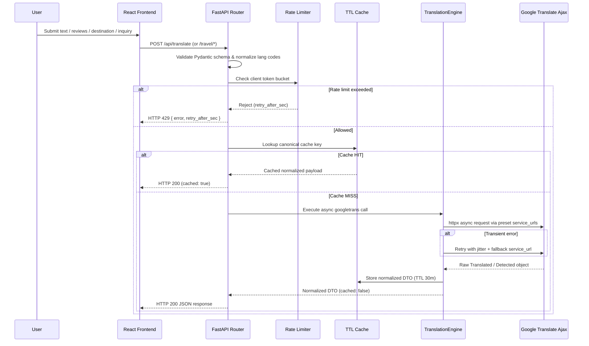

# Lab 07 — WanderLingo (Google Translate API Web Application) Development Plan

**Course:** CS252 — Programming Systems (Week 7)  
**Assignment Reference:** [Lab07-Google Translate API-Firebase API.pdf](./Lab07-Google%20Translate%20API-Firebase%20API.pdf)  
**Tutorial Reference:** [2025 CT - API Translate.docx.pdf](./2025%20CT%20-%20API%20Translate.docx.pdf)  
**Selected API Track:** Google Translate API via Python `py-googletrans` (`googletrans==4.0.2`) — **Firebase API intentionally omitted** *(compliant with "integrates at least one of the two APIs")*  
**Website Concept:** **WanderLingo** — Multilingual Travel Companion Website  
**Architecture:** FastAPI (Python 3.12) Backend + React + TypeScript + Vite + Tailwind CSS Frontend  
**Hosting & Organization (Defaulted for Q3):** Localhost-first inside `W7/WanderLingo/` (with single-command production serving via FastAPI + optional deployment readiness)  
**Total API & Infrastructure Cost:** **\$0** (no API keys, no GCP billing, no paid services)

---

## 1. Professor Requirements & Tutorial Grounding

### 1.1 Mandatory Requirements from `Lab07-Google Translate API-Firebase API.pdf`
- **Core Task (Exercise 01):** Develop a **meaningful website** that integrates **at least one** of the two APIs introduced in the tutorial (Google Translate API or Firebase API). Selecting only the Google Translate API fully satisfies the rubric.
- **Five Mandatory Submission Components:**
  1. **Explanation:** Clear description of the website, its functionality, and how the Google Translate API (`py-googletrans`) is integrated.
  2. **Source Code:** Complete implementation stored cleanly under `W7/WanderLingo/`.
  3. **Video Demonstration:** Screen recording demonstrating every website feature and live API integration.
  4. **AI Usage Declaration:** Transparent breakdown of AI tool usage vs. student ownership and verification.
  5. **Git Commit History:** Clean, atomic commit history exported to `W7/Git_Commit_History.md` showing iterative development.
- **Mandatory Documentation Formats:** Written documentation (Explanation + AI Usage Declaration) must be submitted in **both Markdown (`.md`, text-based) and PDF (`.pdf`, binary)** formats.

### 1.2 Direct Traceability to `2025 CT - API Translate.docx.pdf`
Every concept and travel use case taught in the professor's tutorial maps directly to a concrete feature in **WanderLingo**:

| Tutorial Section | Concept / API Taught | How WanderLingo Implements & Extends It |
| :--- | :--- | :--- |
| **Sec. 1–2 (Setup & Languages)** | `googletrans`, `LANGUAGES` (100+ languages), `travel_languages` quick subset (`en`, `vi`, `fr`, `es`, `zh*`, `ja`, `ko`, `th`) | Dynamically exposes `googletrans.LANGUAGES` via `GET /api/languages` with a searchable combobox pinning the 8 travel languages at the top *(with runtime verification of `zh` vs. `zh-cn`/`zh-tw`)* |
| **Sec. 3–4 (Core Features)** | `Translator()`, `translate(text, src, dest)` returning `.text`, `.src`, `.dest`, `.origin`, `.pronunciation`; `detect(text)` returning `.lang`, `.confidence` | **Workspace 1: Live Travel Translator & Phrasebook** — real-time translation, auto-detection badge with confidence score, phonetic pronunciation display (e.g., romanization for JA/KO/ZH/TH), language swap, and categorized travel phrase presets |
| **Sec. 4 (Bulk Translation)** | `translator.translate([list_of_texts], dest=...)` | Dedicated `POST /api/translate/bulk` endpoint and batch UI powering multi-review and multi-line translation with per-item status reporting |
| **Sec. 5 (Advanced Features)** | Custom `service_urls` redundancy (`translate.google.com`, `translate.google.co.kr`, `translate.google.co.jp`) & direct endpoint (`translate.googleapis.com`) | Configurable `service_urls` preset selector in the UI header/inspector (`Default`, `Direct googleapis`, `Multi-Domain Failover`) backed by centralized backend config — never hardcoded inside handlers |
| **Sec. 6 — Example 1** | **Hotel Review Translation System** (auto-detect, skip if already in target language, return original/translated/source_lang/confidence, error handling) | **Workspace 3: Hotel Review Translator** — preloaded with the tutorial's 3 Vietnamese reviews + international reviews; supports pasting/adding custom reviews, skips same-language items cleanly, shows confidence scores and language distribution stats |
| **Sec. 6 — Example 2** | **Travel Inquiry Language Processor** (detect language + name from `LANGUAGES`, `needs_translation` boolean, translate multilingual guest inquiries) | **Workspace 4: Travel Inquiry Desk** — preloaded with the tutorial's 4 multilingual inquiries (VI, EN, ES, JA); detects guest language, translates to staff language, and adds **two-way concierge reply translation** back into the guest's language |
| **Sec. 6 — Example 3** | **Travel Destination Information Translator** (translate structured dict string fields while preserving non-string fields) | **Workspace 2: Destination Guide Translator** — preloaded with the tutorial's Hanoi record + Ho Chi Minh City, Da Nang, Tokyo, Paris, and Bangkok; translates all text fields while preserving numeric/metadata fields, plus a **Custom Destination Form/JSON Translator** |
| **Sec. 7 (Next Steps)** | Error handling & retry logic, rate limiting for scale, travel datasets, multi-language testing | Server-side retry + `service_urls` failover, token-bucket rate limiter (`429` + `Retry-After`), TTL LRU response cache, input validation, and automated test suite |

### 1.3 Verified Local Environment & `googletrans==4.0.2` Engineering Constraints
Verified directly on this machine before planning:
- **System Python:** `3.12.10` (`venv` module available).
- **Repository Root `.venv`:** Python `3.12.16` with `httpx 0.28.1`, `starlette 1.10.0`, `uvicorn 0.54.0`, and AI/data libraries. **Must NOT be modified** so existing lab environments stay intact.
- **Node.js / npm:** `Node v26.13.1`, `npm 11.20.0` *(Note: Windows PowerShell execution policy restricts `npm.ps1`, so all frontend CLI commands use `npm.cmd` and `npx.cmd`)*.
- **Git:** `2.51.2.windows.1`. Note that the repo root `.gitignore` currently contains only `.opencode`, so a dedicated `.gitignore` inside `W7/WanderLingo/` is mandatory in Phase 0.
- **Why `googletrans==4.0.2` instead of the tutorial's `3.1.0a0` / `4.0.0rc1`:**
  - The tutorial lists 2020 pre-releases (`3.1.0a0` / `4.0.0rc1`) that pin legacy `httpx==0.13.3` and frequently fail on Python 3.12.
  - `googletrans==4.0.2` (stable release, Jan 2025) supports Python 3.12 and modern `httpx`, uses native `async`/`await` (`async with Translator(...) as translator:`), and fits FastAPI's async request lifecycle naturally without blocking worker threads.
  - This deliberate version upgrade and rationale will be explicitly documented in the Lab 07 Explanation report.
- **Three Known Unofficial-API Pitfalls Guarded in Phase 0:**
  1. **Chinese Language Code Normalization:** The tutorial lists `'zh': 'chinese'`, whereas `googletrans.LANGUAGES` commonly uses `'zh-cn'` / `'zh-tw'`. Phase 0 will inspect `googletrans.LANGUAGES` live and normalize aliases (`'zh'` -> `'zh-cn'`) so no language button throws `ValueError`.
  2. **Nullable/Polymorphic `Detected.confidence`:** Depending on input length or mixed scripts, `googletrans` can return `float`, `list`, or `None` for `.confidence`. Our service normalizer will handle all three safely (`float | None`).
  3. **Upstream Rate Limits (`429`) & Transient Failures:** Because `py-googletrans` uses Google Translate's public Ajax endpoint, rapid repeated calls can trigger throttling. Caching, bounded batch sizes, rate limiting, and `service_urls` failover protect both development and video recording.

---

## 2. What Is Needed to Be Built (Feature & Requirement Specification)

### 2.1 Core Website Workspaces (4-Tab Travel Companion UX)

#### Workspace 1 — Live Travel Translator & Phrasebook
- **Purpose:** Instant two-pane text translation and language detection for travelers.
- **Required Features:**
  - Source language selector (`Auto-Detect` default + searchable full `googletrans.LANGUAGES` list with 8 pinned travel languages) and Destination language selector + one-click **Swap Languages** button.
  - Real-time character counter (enforcing a clean `5,000`-character limit) and **Detect Language Only** button showing detected language name, ISO code, and confidence meter.
  - Translated output pane showing translated text, detected source language badge (when `src=auto`), **Pronunciation / Romanization** readout (whenever `result.pronunciation` is available and distinct from translated text), one-click **Copy**, and **Cache Hit / Latency** metadata badge.
  - **Travel Phrasebook Drawer/Chips:** Categorized ready-to-click travel phrases (*Airport & Transit*, *Hotel Check-In*, *Food & Allergies*, *Directions*, *Emergency*) that populate the translator immediately.
  - **Recent Translation History:** Saved locally in `localStorage` (up to 30 items, zero Firebase dependency) with click-to-restore and clear-history controls.

#### Workspace 2 — Destination Guide Translator *(Tutorial Example 3)*
- **Purpose:** Translate structured travel destination cards field-by-field while preserving non-string data.
- **Required Features:**
  - Curated multi-destination dataset preloaded on backend:
    - **Hanoi** *(using the exact 5 tutorial fields: `name`, `description`, `attractions`, `food_specialties`, `best_time_to_visit`, plus non-string metadata `avg_daily_budget_usd: 45`, `rating: 4.8`, `unesco_sites: 1` to prove non-string preservation)*.
    - Additional rich destinations: **Ho Chi Minh City**, **Da Nang**, **Tokyo**, **Paris**, **Bangkok**.
  - Target language selector + **"Translate Destination Guide"** action calling `POST /api/travel/destination`.
  - Side-by-side or toggleable **Original vs. Translated** structured card view clearly tagging translated string fields vs. preserved non-string metadata fields.
  - **Custom Destination Translator Mode:** Toggleable form or JSON editor allowing the user/grader to type their own destination dictionary and translate all text fields dynamically.

#### Workspace 3 — Hotel Review Translator *(Tutorial Example 1 + Bulk Translation)*
- **Purpose:** Batch-translate mixed-language guest reviews into a single readable language without wasting calls on reviews already in the target language.
- **Required Features:**
  - Preloaded hotel review board containing the tutorial's **3 Vietnamese hotel reviews verbatim** plus realistic reviews in **English, Japanese, French, Spanish, and Korean** (with author name, star rating, stay date, and review body).
  - Target language selector (default `en`, switchable to `vi` or any supported language) + **"Translate All Reviews"** bulk action calling `POST /api/travel/reviews`.
  - **Skip-If-Same-Language Logic:** Reviews whose detected language matches `target_language` are marked `skipped: true` with a clear *"Already in target language"* badge (zero redundant translation call).
  - Each review card displays: Detected Language badge, Confidence score (`0–100%` or `N/A`), Original text (collapsible or side-by-side), Translated text, and error badge if an individual item fails (partial-failure resilience, never crashing the whole list).
  - **Custom Bulk Input:** Users can add a new review card or paste multi-line reviews (one per line, up to 25 per batch) to live-test bulk translation.
  - **Language Summary Bar:** Automatically computes total reviews, translated count, skipped count, and breakdown by detected language.

#### Workspace 4 — Travel Inquiry Desk *(Tutorial Example 2 + Two-Way Concierge Loop)*
- **Purpose:** Simulate a multilingual hotel/tour concierge desk processing incoming international inquiries and replying in the traveler's native language.
- **Required Features:**
  - Preloaded queue with the tutorial's **4 multilingual inquiries verbatim**:
    1. `"Tôi muốn đặt phòng khách sạn ở Hà Nội"` (Vietnamese)
    2. `"I want to book a hotel in Hanoi"` (English)
    3. `"¿Hay tours disponibles para mañana?"` (Spanish)
    4. `"空港からホテルまでの交通手段は？"` (Japanese)
  - Plus a **"New Traveler Inquiry"** composer so the user/grader can submit any custom foreign-language message.
  - Staff working language selector (default `en` or `vi`).
  - Clicking **"Process Inquiry"** (or **"Process All"**) calls `POST /api/travel/inquiry` and displays:
    - Detected language full name (from `LANGUAGES`) + ISO code + confidence score
    - `needs_translation` status badge (`Translation Applied` vs. `No Translation Needed`)
    - Original inquiry + staff-language translation
  - **Two-Way Reply Feature:** Staff types a reply in the staff language and clicks **"Translate Reply to Guest Language"** -> calls `POST /api/travel/inquiry/reply` targeting the guest's detected `lang` code, showing both the staff text and the translated guest reply with pronunciation (when applicable) and Copy button.

### 2.2 Cross-Cutting UI/UX & Engineering Requirements
- **Bilingual Interface (`EN` default / `VI` toggle):**
  - Stored in `localStorage` (`wanderlingo_locale`).
  - Compile-time checked TypeScript dictionaries (`en.ts` and `vi.ts: Record<keyof typeof en, string>`) ensuring 100% key parity across every label, button, error banner, and empty state.
- **Light & Dark Mode (Follows OS Preference):**
  - Pre-paint inline script in `index.html` sets `document.documentElement.dataset.theme` (`light` | `dark`) from `localStorage` (`wanderlingo_theme`) or `prefers-color-scheme` to prevent theme flicker.
- **Service URL & API Inspector Pill (Header / Drawer):**
  - Shows live backend connection status (`GET /api/health`), `googletrans` version (`4.0.2`), cache hit count, and lets the user switch between the 3 `service_urls` presets (`Default`, `Direct googleapis.com`, `Multi-domain failover`) right from the UI.
- **Responsive Design & Accessibility:**
  - Clean layout across Desktop (`>= 1024px`), Tablet (`768px–1023px`), and Mobile (`< 768px`).
  - Semantic HTML landmarks, keyboard-accessible tabs and combobox, `aria-live="polite"` status feedback, skeleton/spinner loading states, and actionable bilingual error banners for validation (`422`), rate limit (`429` with countdown), or upstream failure (`502`/`504`).

---

## 3. System Architecture & Request Lifecycle

### 3.1 High-Level Architecture (Localhost-First Full Stack)

```mermaid
flowchart LR
    Browser["User Browser (EN/VI, Light/Dark)"]
    Vite["React + TS + Vite SPA (Dev :5173 / Built dist)"]
    API["FastAPI Server (127.0.0.1:8000)"]
    RL["Token-Bucket Rate Limiter"]
    Cache["In-Memory TTL LRU Cache"]
    Engine["TranslationEngine (Normalize + Retry + Failover)"]
    GT["py-googletrans 4.0.2 (httpx Async)"]
    Google["Google Translate Ajax Endpoints"]

    Browser -->|"UI Interactions"| Vite
    Vite -->|"JSON REST /api/*"| API
    API --> RL
    RL --> Cache
    Cache -.->|"Cache HIT"| API
    Cache -->|"Cache MISS"| Engine
    Engine --> GT
    GT -->|"HTTPS (service_urls)"| Google
    Google --> GT
    GT --> Engine
    Engine --> Cache
    API -->|"Normalized JSON"| Vite
```



### 3.2 Two Execution Modes (Localhost-First Default)
1. **Development Mode (Hot Reload):**
   - Terminal 1: FastAPI via `uvicorn app.main:app --reload --port 8000` (inside `W7/WanderLingo/backend/.venv`).
   - Terminal 2: Vite dev server via `npm.cmd run dev` on `http://localhost:5173`, proxying `/api/*` directly to `http://127.0.0.1:8000` in `vite.config.ts`.
2. **Single-Command Demo / Grading Mode:**
   - Run `npm.cmd run build` once in `frontend/` -> generates `frontend/dist/`.
   - FastAPI mounts `frontend/dist/` as static files with SPA fallback when present, so running a single script (`W7/WanderLingo/start.ps1` or `uvicorn app.main:app --port 8000`) serves **both the website and `/api/*`** at `http://127.0.0.1:8000`.
3. *(Optional Future Cloud Deployment)* Because FastAPI already serves the compiled frontend on a single port with zero secrets required, packaging a `Dockerfile` / Render service later requires no architectural refactoring.

### 3.3 Translation Request Sequence (Showing Resilience Layer)



---

## 4. Required Stack, Dependencies & Directory Layout

### 4.1 Backend Dependencies (`W7/WanderLingo/backend/requirements.txt`)
All installed exclusively inside `W7/WanderLingo/backend/.venv`:

| Package | Version Strategy | Purpose |
| :--- | :--- | :--- |
| `googletrans` | `==4.0.2` | Core async Python wrapper for Google Translate (`Translator`, `LANGUAGES`) |
| `fastapi` | `>=0.115,<1.0` | Async REST framework with automatic OpenAPI docs (`/docs`) and Pydantic validation |
| `uvicorn[standard]` | `>=0.32,<1.0` | ASGI server serving API + built static frontend |
| `pydantic` | `>=2.9,<3.0` | Strict request/response contracts & validation |
| `pytest` | `>=8.3,<9.0` | Automated unit & API test runner |
| `pytest-asyncio` | `>=0.24,<1.0` | Async unit tests for `TranslationEngine` |
| `httpx` | *(resolved by `googletrans==4.0.2`)* | Underlying async HTTP client + FastAPI `TestClient` / `AsyncClient` testing |

### 4.2 Frontend Dependencies (`W7/WanderLingo/frontend/package.json`)

| Package | Version Target | Purpose |
| :--- | :--- | :--- |
| `react`, `react-dom` | `^19.x` | Component UI & state management |
| `typescript` | `^5.x` | Strict typing for API DTOs and EN/VI i18n key parity |
| `vite`, `@vitejs/plugin-react` | `^6.x` | Fast dev server, `/api` proxy, and production static build |
| `tailwindcss`, `@tailwindcss/vite` | `^4.x` | Responsive styling paired with semantic Light/Dark CSS tokens |
| `lucide-react` | `^0.x` | Crisp ISC-licensed UI icons |
| `vitest`, `@testing-library/react`, `jsdom` | Latest compatible | Unit tests for i18n parity, formatters, and component behavior |

### 4.3 Proposed Directory Layout

```text
W7/
├── Lab07-Google Translate API-Firebase API.pdf
├── 2025 CT - API Translate.docx.pdf
├── Development_Plan.md                    # This development plan
├── README.md                              # Lab 07 submission overview, run guide & demo checklist
├── Git_Commit_History.md                  # Exported atomic commit log for Lab 07
├── docs/
│   ├── Lab07_Explanation_and_AI_Declaration.md
│   └── Lab07_Explanation_and_AI_Declaration.pdf
└── WanderLingo/
    ├── .gitignore                         # Ignores .venv/, node_modules/, dist/, __pycache__/, .pytest_cache/
    ├── start.ps1                          # Single-command Windows PowerShell launcher (single-port mode)
    ├── backend/
    │   ├── requirements.txt
    │   ├── scripts/
    │   │   └── smoke_googletrans.py       # Phase 0 live verification script for googletrans==4.0.2
    │   ├── app/
    │   │   ├── __init__.py
    │   │   ├── config.py                  # Centralized SERVICE_URL_PRESETS, limits, TTL, CORS
    │   │   ├── schemas.py                 # Pydantic request/response DTOs
    │   │   ├── main.py                    # FastAPI app, routers, error handlers, static SPA mount
    │   │   ├── data/
    │   │   │   └── travel_samples.py      # Tutorial examples verbatim + extended travel datasets
    │   │   ├── services/
    │   │   │   ├── cache.py               # Bounded LRU + TTL async-safe cache
    │   │   │   ├── rate_limiter.py        # Sliding-window / token-bucket limiter
    │   │   │   ├── adapter.py             # GoogleTransAdapter protocol + real googletrans==4.0.2 impl
    │   │   │   └── translator_service.py  # Normalization, skip-same-lang, retry/failover, bulk & travel workflows
    │   │   └── routers/
    │   │       ├── system.py              # GET /api/health, GET /api/languages
    │   │       ├── translate.py           # POST /api/detect, /api/translate, /api/translate/bulk
    │   │       └── travel.py              # GET /api/travel/samples, POST /reviews, /inquiry, /inquiry/reply, /destination
    │   └── tests/
    │       ├── conftest.py                # Deterministic FakeGoogleTransAdapter fixture
    │       ├── test_translator_service.py # Normalization, skip-same-lang, cache, retry, failover, dict preservation
    │       ├── test_rate_limiter.py       # Burst allowance & 429 Retry-After behavior
    │       └── test_api_routes.py         # Full FastAPI HTTP contract tests across all endpoints
    └── frontend/
        ├── index.html                     # Pre-paint theme init script + title "WanderLingo"
        ├── package.json
        ├── tsconfig.json
        ├── vite.config.ts                 # /api proxy to 127.0.0.1:8000
        └── src/
            ├── main.tsx
            ├── App.tsx
            ├── index.css                  # Light/Dark semantic tokens + typography
            ├── config/
            │   └── apiConfig.ts           # Centralized endpoint paths & default constants
            ├── types/
            │   └── translate.ts           # Canonical TypeScript DTOs mirroring backend schemas.py
            ├── services/
            │   └── apiClient.ts           # Typed fetch wrapper + AbortController + structured ApiError
            ├── i18n/
            │   ├── en.ts
            │   ├── vi.ts
            │   └── I18nContext.tsx
            ├── context/
            │   └── ThemeContext.tsx
            ├── hooks/
            │   ├── useLanguages.ts
            │   └── useTranslationHistory.ts
            ├── components/
            │   ├── TopBar.tsx             # Brand, 4 workspace tabs, EN/VI, Light/Dark, Service URL preset pill
            │   ├── LanguageCombobox.tsx   # Searchable 100+ language selector with pinned travel languages
            │   ├── StatusBanner.tsx       # Typed error/rate-limit countdown/cache badges
            │   ├── LiveTranslatorPanel.tsx
            │   ├── PhrasebookBar.tsx
            │   ├── HistoryDrawer.tsx
            │   ├── DestinationGuidePanel.tsx
            │   ├── HotelReviewsPanel.tsx
            │   ├── InquiryDeskPanel.tsx
            │   └── Footer.tsx
            └── __tests__/
                ├── i18nParity.test.ts     # Guarantees EN and VI dictionaries have identical keys
                └── apiClient.test.ts      # Error parsing & abort handling tests
```

---

## 5. Building Method (Exact Technical Specifications)

### 5.1 Centralized Configuration (`backend/app/config.py`)
Never hardcode service URLs or magic limits inside route handlers. Define all runtime settings centrally:
- `SERVICE_URL_PRESETS`:
  - `"default"`: `["translate.google.com"]`
  - `"direct"`: `["translate.googleapis.com"]` *(Tutorial Section 5 direct endpoint)*
  - `"redundant"`: `["translate.google.com", "translate.google.co.kr", "translate.google.co.jp"]` *(Tutorial Section 5 multi-domain redundancy)*
  *(Exact working compatibility of each preset with `googletrans==4.0.2` will be live-verified in Phase 0 and adjusted only if an upstream domain fails.)*
- `MAX_TEXT_LENGTH = 5000` characters per single text.
- `MAX_BULK_ITEMS = 25` items per bulk/review batch request.
- `CACHE_TTL_SECONDS = 1800` (30 minutes), `CACHE_MAX_ENTRIES = 500`.
- `RATE_LIMIT_REQUESTS = 60` per `60` seconds per client IP (bypassed for `GET /api/health` and `GET /api/languages`).
- `RETRY_ATTEMPTS = 2`, backoff delays `0.4s` and `1.0s` with failover to alternate `service_urls`.
- `REQUEST_TIMEOUT_SECONDS = 10.0`.

### 5.2 REST API Contract Catalog

| Method & Endpoint | Request Payload (Key Fields) | Response Payload (Key Fields) | Tutorial Mapping |
| :--- | :--- | :--- | :--- |
| `GET /api/health` | — | `{ status, googletrans_version, active_presets, cache_size, cache_hits, cache_misses }` | Sec. 2 (Verify install) & Sec. 5 |
| `GET /api/languages` | — | `{ total_count, travel_languages: [{code, name}], all_languages: [{code, name}] }` | Sec. 2 (`LANGUAGES` + `travel_languages`) |
| `POST /api/detect` | `{ text, service_preset? }` | `{ text, lang, lang_name, confidence, cached, service_preset, latency_ms }` | Sec. 4 (`detect()`) |
| `POST /api/translate` | `{ text, src="auto", dest="vi", service_preset? }` | `{ origin, text, src, src_name, dest, dest_name, pronunciation, skipped, cached, service_preset, latency_ms }` | Sec. 3–4 (`translate()`) |
| `POST /api/translate/bulk` | `{ texts: string[], src="auto", dest="en", skip_same_language=true, service_preset? }` | `{ items: [BulkItemResult], summary: { total, translated, skipped, failed, language_breakdown } }` | Sec. 4 (Bulk translation) |
| `GET /api/travel/samples` | — | `{ destinations: [...], reviews: [...], inquiries: [...], phrasebook: [...] }` | Sec. 6 (Examples 1–3 datasets) |
| `POST /api/travel/reviews` | `{ reviews: [{ id?, author?, rating?, text }], target_language="en", service_preset? }` | `{ target_language, target_language_name, results: [{ ..., original, translated, source_lang, source_lang_name, confidence, skipped, error? }], summary }` | Sec. 6 — Example 1 (Hotel Reviews) |
| `POST /api/travel/inquiry` | `{ inquiry_text, target_language="en", service_preset? }` | `{ original_text, detected_lang, detected_language, confidence, translated_text, needs_translation, pronunciation, cached, error? }` | Sec. 6 — Example 2 (Travel Inquiry) |
| `POST /api/travel/inquiry/reply` | `{ reply_text, staff_language="en", guest_language, service_preset? }` | `{ staff_text, translated_reply, src, dest, dest_name, pronunciation, skipped, cached }` | Sec. 6 — Example 2 (Two-Way Extension) |
| `POST /api/travel/destination` | `{ destination_data: Record<string, Any>, target_language="vi", service_preset? }` | `{ target_language, target_language_name, original_data, translated_data, translated_fields: string[], preserved_fields: string[], field_errors: Record<string, string> }` | Sec. 6 — Example 3 (Destination Info) |

### 5.3 Core Backend Encoding Methods

1. **Adapter Interface (`app/services/adapter.py`):**
   - Defines an abstract protocol `TranslatorAdapter` with `async def translate(text, src, dest, service_urls)` and `async def detect(text, service_urls)`.
   - Real implementation `GoogleTrans4Adapter` wraps `async with Translator(service_urls=service_urls) as translator:` from `googletrans==4.0.2`.
   - **Why this method matters:** Automated `pytest` suites test every edge case (retries, failover, partial batch errors, caching, non-string field preservation, skip-same-language) deterministically offline in milliseconds without hitting Google's rate limits, while `scripts/smoke_googletrans.py` verifies real live network behavior.

2. **Language Normalization & Validation (`translator_service.py`):**
   - On startup, inspect `googletrans.LANGUAGES` to build canonical `VALID_CODES` and alias map (e.g., mapping `'zh'` -> `'zh-cn'` if `'zh'` is absent from `LANGUAGES`, `'zh-hans'` -> `'zh-cn'`, `'zh-hant'` -> `'zh-tw'`).
   - Reject unknown language codes cleanly with HTTP `422` and a descriptive message rather than letting raw library exceptions leak as `500`.

3. **Skip-If-Same-Language & Confidence Normalization:**
   - For reviews (Example 1) and inquiries (Example 2), run `detect(text)` first; normalize `confidence` (`float` rounded to 4 decimals, or first element if `list`, or `None` if omitted).
   - Compare canonicalized `detected_lang == normalized_target_lang`. If equal, bypass `translate()` entirely, return original text with `skipped=True` / `needs_translation=False`, saving an upstream API call.

4. **Bulk Concurrency Control (Anti-Throttling):**
   - For bulk reviews and multi-field destination dictionaries, avoid firing 20 unbounded concurrent requests at once (which triggers Google `429`).
   - Use an `asyncio.Semaphore(3)` (max 3 concurrent upstream calls) combined with cache lookup first and per-item `try/except`, so one failing item records `error` while all other items still succeed.

5. **Destination Field Translation (`translate_destination_info`):**
   - Mirrors Tutorial Example 3 directly: iterates `(key, value)` pairs; if `isinstance(value, str) and value.strip()`, translates `value` and appends `key` to `translated_fields`; otherwise preserves `value` unchanged (numbers, booleans, arrays of numbers, nulls) and appends `key` to `preserved_fields`.
   - Optionally handles lists of strings cleanly if provided in custom user JSON while still preserving numeric/boolean metadata verbatim.

6. **Frontend State & UX Method:**
   - Single-source-of-truth DTOs in `frontend/src/types/translate.ts` matching `backend/app/schemas.py`.
   - Every async action attaches an `AbortController` so rapid tab switching or re-submissions cancel stale requests cleanly.
   - `ThemeContext` + CSS variables (`--bg-canvas`, `--bg-surface`, `--bg-muted`, `--border-subtle`, `--text-primary`, `--text-secondary`, `--accent-primary`, `--status-good`, `--status-caution`, `--status-warning`) ensure accessible contrast (`>= 4.5:1`) in both Light and Dark themes.
   - `I18nContext` uses strict TypeScript key typing (`en.ts` as source schema, `vi.ts: Record<keyof typeof en, string>`) verified by a Vitest parity test.

---

## 6. Phased Building Process & Verification Gates

Every phase ends with a concrete verification gate and a clean atomic Git commit so `W7/Git_Commit_History.md` tells an authentic engineering story.

| Phase | Scope & Deliverables | Verification Gate (Must Pass Before Next Phase) | Planned Atomic Commit |
| :--- | :--- | :--- | :--- |
| **Phase 0: Setup & Live API Audit** | Create `W7/WanderLingo/.gitignore`; create isolated `W7/WanderLingo/backend/.venv` (Python 3.12); install `googletrans==4.0.2`, `fastapi`, `uvicorn`, `pytest`, `pytest-asyncio`; run `scripts/smoke_googletrans.py` testing `LANGUAGES` (including `zh*`), `translate()`, `detect()`, `.pronunciation`, bulk list, and all 3 `service_urls` presets | Smoke script prints verified `googletrans.__version__`, confirmed language count, real EN->VI / JA->EN translations, confidence output type, and confirmed working `service_urls`; root `.venv` untouched; `git status` shows zero ignored artifacts | `chore(w7): setup WanderLingo workspace, gitignore, and verify googletrans 4.0.2` |
| **Phase 1: Backend Core & Services** | Implement `app/config.py`, `app/schemas.py`, `app/data/travel_samples.py`, `app/services/{cache,rate_limiter,adapter,translator_service}.py`, `app/routers/{system,translate,travel}.py`, `app/main.py` | Uvicorn starts cleanly; Swagger UI at `http://127.0.0.1:8000/docs` loads all endpoints; live `curl`/`Invoke-RestMethod` checks pass for `/health`, `/languages`, `/translate`, `/detect`, `/travel/reviews`, `/travel/inquiry`, `/travel/destination` | `feat(w7): implement FastAPI backend wrapping py-googletrans with cache, retry, and rate limiting` |
| **Phase 2: Backend Automated Test Suite** | Write `tests/{conftest,test_translator_service,test_rate_limiter,test_api_routes}.py` covering all routes, Chinese code alias normalization, nullable confidence, skip-same-language, dict non-string preservation, cache hits, failover retries, `422` validation, and `429` rate limits | `pytest -v` passes 100% offline with zero warnings/failures | `test(w7): add backend unit and FastAPI contract test suite` |
| **Phase 3: Frontend Foundation** | Scaffold `frontend/` (React + TS + Vite + Tailwind v4); configure `/api` proxy; implement `ThemeContext` (pre-paint Light/Dark), `I18nContext` (EN/VI), `apiConfig`, `apiClient`, `TopBar`, `LanguageCombobox`, `StatusBanner`, `Footer` | `npx.cmd tsc --noEmit`, `npm.cmd test` (EN/VI parity + client tests), and `npm.cmd run build` all pass cleanly | `feat(w7): scaffold React TypeScript frontend with Light/Dark theme, EN/VI i18n, and language combobox` |
| **Phase 4: Four Interactive Workspaces** | Implement `LiveTranslatorPanel` + `PhrasebookBar` + `HistoryDrawer`, `DestinationGuidePanel` (curated + custom JSON/form), `HotelReviewsPanel` (bulk + language summary + custom paste), and `InquiryDeskPanel` (multilingual intake + two-way staff reply) | Live end-to-end check against running FastAPI across all 4 tabs in EN & VI, Light & Dark modes, and Desktop (1440px) / Mobile (375px) viewports; verify `start.ps1` single-command production mode (`http://127.0.0.1:8000`) | `feat(w7): build live translator and destination guide workspaces`<br>`feat(w7): build hotel review bulk translator and two-way travel inquiry desk` |
| **Phase 5: Lab 07 Docs, PDF Export & Demo Prep** | Write `W7/docs/Lab07_Explanation_and_AI_Declaration.md` + export verified `.pdf`; export `W7/Git_Commit_History.md`; write `W7/README.md` with setup instructions & video demo script; record demo video | All 5 assignment rubric items verified present in `W7/` (`.md` + `.pdf` rendered cleanly, complete source code, Git log, video demo checklist) | `docs(w7): add Lab07 explanation, AI declaration (.md/.pdf), commit log, and README` |

---

## 7. Risks & Mitigations

| Risk | Likelihood | Impact | Concrete Mitigation |
| :--- | :---: | :---: | :--- |
| **Google Translate `429 Too Many Requests`** during rapid testing or live video recording | Medium | High | Server-side TTL LRU cache prevents duplicate calls; bounded concurrency (`Semaphore(3)`) prevents burst spikes; `service_urls` failover retries alternate endpoints; UI displays a clear countdown banner instead of crashing |
| **`translate.googleapis.com` vs. `translate.google.com` behavior in `4.0.2`** | Low–Med | Medium | Verified empirically in Phase 0 (`smoke_googletrans.py`) before building UI presets; only working domains remain active in presets |
| **Language code mismatch (`zh` vs `zh-cn`)** from tutorial sample dict | High | Medium | Backend dynamically loads `googletrans.LANGUAGES` and maps `'zh'` -> `'zh-cn'` (verified in Phase 0) |
| **Windows PowerShell blocks `npm.ps1`** | Confirmed | Low | Use `npm.cmd` / `npx.cmd` in all commands and `start.ps1` without changing user OS execution policy |
| **Accidental commit of `.venv/` or `node_modules/`** | Medium | High | Add `W7/WanderLingo/.gitignore` in Phase 0 before creating `.venv/` or running `npm.cmd install`; verify `git status` before every commit |

---

## 8. Video Demonstration Plan (3–5 Minutes)

To satisfy the **Video Demonstration** rubric item cleanly in a single take:
1. **Launch & Architecture Proof (~30s):** Run `start.ps1`, open `http://127.0.0.1:8000` (and briefly flash `/docs` Swagger UI + backend health pill showing `googletrans 4.0.2`).
2. **Workspace 1 — Live Translator & Phrasebook (~45s):** Translate a travel phrase with auto-detection, show detected language + confidence + Japanese/Korean/Chinese pronunciation, swap languages, click a phrasebook chip, toggle EN/VI and Dark/Light mode.
3. **Workspace 2 — Destination Guide Translator (~45s):** Open Hanoi (matching Tutorial Example 3), translate to Vietnamese and Japanese showing translated text fields vs. preserved numeric metadata, then test a quick custom destination input.
4. **Workspace 3 — Hotel Review Translator (~50s):** Run bulk translation on mixed-language reviews (including tutorial's Vietnamese reviews + English review), highlight the *"Skipped — already in target language"* badge, confidence scores, and language breakdown summary.
5. **Workspace 4 — Travel Inquiry Desk (~50s):** Process the 4 multilingual inquiries (VI/EN/ES/JA), highlight `needs_translation` detection, then write an English staff reply and reverse-translate it back into Japanese for the guest.
6. **Advanced Features Proof (~20s):** Switch `service_urls` preset in the status bar and trigger a cached re-translation showing the `Cached` badge + low latency.

---

## 9. Final Submission Checklist (`W7/`)

- [ ] **Explanation (`.md` + `.pdf`):** `W7/docs/Lab07_Explanation_and_AI_Declaration.md` and `.pdf`
- [ ] **AI Usage Declaration (`.md` + `.pdf`):** Included clearly in both `.md` and `.pdf`
- [ ] **Complete Source Code:** `W7/WanderLingo/` (cleanly excluding `.venv/`, `node_modules/`, `dist/`)
- [ ] **Git Commit History:** Exported to `W7/Git_Commit_History.md`
- [ ] **Video Demonstration:** Recorded and linked/stored per course submission instructions
- [ ] **Automated Verification Passing:** Backend `pytest -v`, Frontend `npx.cmd tsc --noEmit`, `npm.cmd test`, and `npm.cmd run build`
